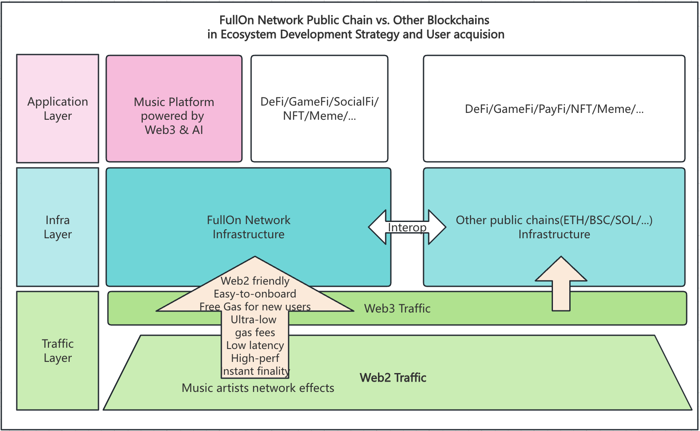

# **FullOn Network** Protocol White Paper
***Building a Highly Scalable, Interoperable Layer-1 Blockchain***

```
Whitepaper version: v2.1.0
FLON Core version: v0.8.5
FLON CDT version: v0.8.5
Date: Oct. 20, 2026
Author: FullOn Labs
Email: fullonlabs @ gmail dot com
```


## Table of Contents

- [01. Abstract](#01-abstract)
- [02. Introduction](#02-introduction)
- [03. Why FullOn](#03-why-FullOn)
- [04. Design Principles](#04-design-principles)
- [05. How FullOn Works](#05-how-fullon-works)
   - [Overall architecture](#overall-architecture)
   - [Technical specifications](#technical-specifications)
   - [Core designs](#core-designs)
     - [Account types](#account-types)
     - [Interoperability](#interoperability)
     - [Scalability](#scalability)
     - [Resource model](#resource-model)
     - [Governance](#governance)
   - [Vertical ecosystems](#vertical-ecosystems)
   - [Implementation](#implementation)
- [06. Tokenomics](#06-tokenomics)
   - [Token distribution](#token-distribution)
   - [Category detail](#category--detail)
     - [Team and core contributors](#team-and-core-contributors)
     - [Community airdrops](#community-airdrops)
     - [Seed investors](#seed-investors)
     - [Private sale](#private-sale)
     - [Public sale](#public-sale)
     - [Block Producer rewards](#block-producer-rewards)
     - [Strategic partnership](#strategic-partnership)
     - [Foundation endowment](#foundation-endowment)
   - [Inflation](#inflation)
   - [Deflation](#deflation)
- [07. The Future](#07-the-future)
- [08. Disclaimer](#08-disclaimer)

<div align="justify">

# 01. Abstract

**FullOn** is a layer-1 decentralization protocol, positioned to become the leading platform for real-world applications in the Web3, A.I., and Metaverse ecosystems — with a special focus on revolutionizing the **music** industry as a dedicated public chain for global creators, fans, and participants.

Designed to serve mass adoption, FullOn prioritizes scalability, usability, interoperability, security, and true decentralization, empowering the next generation of music experiences where artists, listeners, and the entire music economy can thrive on-chain.

FullOn delivers exceptional scalability by building an ultra-performant layer-1 foundation using innovations like 2D-sharding and modular design. Side-chains or layer-2 solutions are introduced only when specialized needs arise — such as ultra-low latency for live music events, high-volume data for streaming and NFTs, or custom consensus for music-specific applications — ensuring the core chain remains efficient and capable of handling global-scale music interactions.

Usability and interoperability are core pillars, especially for onboarding the broader music community into Web3. Features like sovereign and proxy accounts enable seamless, fast onboarding for artists and fans without deep crypto knowledge. FullOn also provides universal on-chain interoperability with virtually all major blockchains and crypto wallets, delivering a true deploy-once, run-anywhere experience for decentralized music applications (dApps) — whether NFT marketplaces, streaming platforms, royalty distribution systems, fan engagement tools, tokenized music rights, or listen-to-earn models.

By combining massive scalability with music-centric innovation, FullOn aims to become the go-to public chain that transforms the music industry — empowering creators with fair, transparent ownership and monetization, connecting fans directly to artists, and building a vibrant, decentralized music economy for the global Web3 era


# 02. Introduction

The world is now standing at the threshold of the Web3 and A.I. era where major economic and
financial activities could increasingly occur on a blockchain-powered technological foundation.
Apart from launching blockchain networks and issuing cryptocurrencies that can be invested or
speculated by crypto fans amongst themselves, it has been rigorously sought by many industry
pioneers to tokenize and issue real-world assets on-chain, which would certainly open up an
infinite amount of opportunities to rejuvenate the world economy. It has been projected by some
large financial firms like Citi bank that by 2035 the real-world assets to be issued on-chain would
amount to $4 trillion in value. By contrast, the global crypto market capital has surpassed $3.6
trillion as of written and will certainly grow much larger and faster. Blockchain technology and
cryptocurrencies have been not only embraced by many early brave individuals but also recent
financial institutions from around the globe.

Yet, despite hundreds of existing blockchain networks, most still struggle with genuine real-world adoption and scalable applications capable of driving true Web3 realization. Technical hurdles—like limited throughput, high latency, poor usability—and non-technical barriers—such as complex onboarding and fragmented interoperability—have contributed to this gap.

FullOn protocol emerges as a purpose-built solution to these challenges, designed to become the premier decentralized platform powering the Web3, A.I., Metaverse, and especially the music industry ecosystems. As a high-performance layer-1 public chain, FullOn targets mass adoption by addressing core limitations head-on, with a strong emphasis on enabling tokenized music assets, fair royalty distribution, direct artist-fan economies, NFT-based ownership, streaming dApps, and listen-to-earn models.

<div align="center">
<br/>
Figure-1: FullOn Ecosystem Bulding Blocks Overview
</div>

# 03. Why FullOn

By looking into all the popular blockchains, it is not hard to find out that they have met at least
some of the following problems:

  1. **Scalability problem**: sub-kilo TPS that couldn’t meet the requirements of many
real-world applications demanding thousands and even tens of thousands TPS;
  2. **High latency problem**: large block intervals like some value exceeding 10 seconds or
minutes that are simply not acceptable for most users and couldn’t meet the user
experience requirement set by most traditional applications;
  3. **Long finality problem**: many blockchains require over a minute to finalize or confirm a
block, which greatly hurts the user experience and could also lead to the
double-spending problem if not handled properly;
  4. **High transactional cost**: due to limited TPS, much higher gas fees are usually paid by
users in order to make sure their transactions will get accepted into a block faster than
other peer users. That kind of competition could result in gas fees skyrocketing in
network congestion events, which deters the mass adoption by users.
  5. **Front-running issue**: due to the gas-fee model that allows users to specify the gas fee
price for their transactions, users could pay a higher gas fee price in order to front-run
others, which violates the principle of conducting fair trading on-chain!
  6. **Lack of abstract accounts**: most blockchains adopt public-key derived addresses as
on-chain account entities, which couldn’t handle the cases of account recovery when a
private key gets stolen or lost. Some try to implement the abstract account feature
through smart contract, which lacks standards among users and developers.
  7. **Poor interoperability**: most heterogeneous blockchains and their DAPPs do not work
with others, which result in building similar applications for target blockchains repeatedly
or having to limit the DAPPs to one blockchain only. Users also have to create private
keys and accounts repeatedly for each different blockchains;
  8. **Miniscule smart-contract developer base**: Many blockchains tend to come up with
brand new smart contract languages and limit developers to a small set of early
adopters. That limitation of developer base hinders a wide adoption among majority
developers that have already mastered popular and well-tested coding languages.
  9. **Lack of applications/ecosystems**: It is ultimately the applications that make the
underlying blockchain shine. However, most blockchains have no real value other than
being an asset to be held and traded by crypto investors or market speculators,
expecting to get rich in doing so. Most blockchain teams do not have the know-how of
what ecosystems to be enabled or built and thus do not have an idea of how to optimize
the protocol for the target ecosystems. Eventually it results in the protocol itself
becoming useless and obsolete!

The FullOn protocol will address all of the above problems with innovative solutions so that
applications built on top of FullOn protocol will be more capable, accessible and easy-to-use
while retaining all the good parts of blockchain technology like transparency, decentralization
and security.

# 04. Design Principles
Both the design and development of the FullOn platform are guided by a handful of key
principles. These principles reflect the problems inherent in both the centralized and
decentralized systems of today.

1. **Scalability**: The platform should scale with no upper limit as long as there is economic
justification for doing so in order to support enterprise-grade, globally-used applications.
2. **Usability**: Applications deployed to the platform should be seamless to use for end users
and seamless to create for developers. Wherever possible, the underlying technology
itself should fade to the background or be hidden completely from end users. Wherever
possible, developers should use familiar languages and patterns during the development
process. Basic applications should be intuitive and simple to create while more robust
applications should still be secure.
3. **Affordability**: As FullOn is set to be an application platform instead of just being a store
of value, it must make sure the cost of using the network is relatively affordable by the
majority of users.
4. **Sustainable decentralization**: The platform should encourage significant
decentralization both in the short term and the long term in order to properly secure the
value it hosts. The platform and community should be widely and permission-lessly
inclusive and actively encourage decentralization and participation. To maintain
sustainability, both technological and community governance mechanisms should allow
for practical iteration while avoiding capture by any single parties in the long run.
5. **Upgradability**: The protocol should be easy to upgrade once the mainnet network has
been launched. It would be ideal not to change the node software in order to upgrade the
system configurations or even protocol-level logic.
6. **Modularity & Extensibility**: The overall system software shall be well organized by
clean-cut modules, each of which can be easily swapped out and replaced with new
ones for customizability and extensibility.
Last but not least, it is expected that regardless of the underlying technological
implementations and protocol specifications, the above design principles must be strictly
adhered to unless otherwise revised within this paper.

# 05. How FullOn Works
FullOn is commissioned to host virtually an infinite amount of DAPPs and support billions of
users from around the world to become forever citizens in a Web3 and AI powered metaverse
that connects the real world and virtual realities.

To meet the goal, FullOn comes up with a scalable and extensible architecture where
applications shine the most and FullOn protocol serves as a foundation and infrastructure to
foster a safe, open and dynamic environment meanwhile delivering the best developer and user
experiences.

## Overall architecture

As shown in the following diagram, FullOn as a layer-one protocol can directly host all sorts of
DAPPs that can possibly be imagined and created. However, FullOn protocol compatible
layer-two blockchains can be also built to support a unique set of DAPPs like high-frequency
and ultra-low-latency transactional applications. Moreover, FullOn itself can play as a universal
layer-2 blockchain or side chain to other popular protocols like Bitcoin, Ethereum, Solana,
Binance Chain and BASE Chain etc.
<div align="center">
<br/>
Figure-2: FullOn Ecosystem High-level Architecture
</div>

## Technical specifications


| **Key aspect**           | **Value**   | **Description**                                                                                  |
|--------------------------|-------------|--------------------------------------------------------------------------------------------------|
| **Block Interval**       | 0.5-12 sec  | The network utilizes a dynamic block interval that targets `0.5` seconds during active transaction periods, extending to a maximum of `12` seconds during idle periods to conserve resources. |
| **Block Finality**       | 1–1.5 sec   | Optimized for applications to resist double-spending and other attacks                           |
| **TPS**                  | 10,000+     | Single-threaded execution, scalable via multi-threading, multi-sharding, Layer-2, and sidechains |
| **Consensus Algorithm**  | DPoS+Savanna | High throughput and instant finality                                                            |
| **Virtual Machines**     | Dual-VM     | WASM (native) + EVM (100% compatible)                                                            |
| **Native token**         | `$FLON`     | Total supply: `10 billion`                                                                   |   


## Core designs

### Account types

In order to meet various application needs, FullOn protocol support following versatile account
types:
| **Account type** | **Description**                                               |
|------------------|---------------------------------------------------------------|
| Canonical account | The protocol features native, 12-character alphanumeric names—referred to as abstract or 'sovereign' accounts. These accounts must be initialized by an existing account holder who funds the necessary resources using $FLON. Once created, a sovereign account can be governed by a single private key or configured for multi-signature authorization.|
| EVM-address account | EVM type of addresses can be derived from public keys and all FullOn EVM accounts are just addresses and meaningful only within EVM code. Hence there requires a bridging of assets between EVM address accounts and FullOn accounts |
| Proxy account | Users holding a private key to a third-chain like Ethereum can get a proxy account from FullOn through a binding process. Once it gets created, the proxy account holder can bridge assets onto the FullOn network or bridge them back securely |

## Interoperability
By looking at all existing DAPPs one can easily find out that DAPPs built for one blockchain cannot be easily migrated to other blockchains when they are incompatible or heterogeneous to each other. Thus reinventing the wheel has instead become a norm for the Web3 industry as DAPP developers want to harvest the maximum application values by deploying the applications onto as many popular blockchains as possible.

FullOn takes a rather different approach to this by achieving the deploy-once-run-anywhere effect through the built-in proxy account interaction mechanism as shown in the following diagram:
<div align="center">
<br/>
Figure-3: FullOn Interoperability Achieved through Proxy aAcounts
</div>

The overall process goes like this:
1. A user named Alice has been holding assets from another blockchain discovers the FullOn network and wants to participate in some DAPPs deployed on the FullOn network;
1. Without understanding the account models available inside FullOn network, Alice utilizes her existing crypto wallet and existing private key to sign into an DAPP that runs on FullOn network, which will result in a FullOn proxy account to be automatically created for her through a binding process that registers Alice’s public key and address with an auto-allocated proxy account for her;
1. Alice can bridge her crypto assets from the other blockchain onto the FullOn network to be bound with her proxy accounts.
1. With the assets available from Alice’s proxy account, Alice can start interacting with the FullOn DAPPs; Each transaction has two signing steps: one to be signed by Alice’s private key for interaction messages and another to be signed by FullOn proxy miners for submitting Alice’s transaction onto FullOn network on behalf of Alice.
1. Whenever Alice would like to withdraw assets from the FullOn network, Alice can initiate the process to bring back the assets from the proxy account to Alice's original blockchain address or account. Meanwhile, Alice’s FullOn proxy account remains valid and can receive bridged assets from the original network or native assets from the FullOn network.

FullOn protocol ensures the security of the above process through verifying the two signatures from each transaction as mentioned above. As different blockchains may choose different hashing algorithms, signing algorithms and message serialization formats, FullOn protocol implements the verification by taking care of these subtleties for all blockchains where FullOn protocol likes to have interoperability with.


### Scalability

In order to support meet the growth demand and real-world experience, the net throughput of a blockchain protocol must be scalable. FullOn addresses scalability through different levels:

- ***Single threading***: FullOn achieves 10,000 TPS on a single thread to execute all verified transactions;
- ***Multi-threading***: FullOn applies multi-threading by segregating resource-independent transactions to different execution threads to achieve parallelization. Allocation of 10 such threads can yield 100 K TPS for a commodity level FullOn node to achieve;
- ***Multi-sharding***: Through applying sharding, i.e. same blockchain but multiple state shards, FullOn can further increase the scalability at least 10x times, i.e. achieve 1 million TPS;
- ***Layer-2 or sidechains***: as introduced in early sections, layer-2 chains or even side-chains can be introduced in the future to run on top of or side-to-side with FullOn layer-1 network. These chains can be created for specific DAPPs or some vertical ecosystems.
FullOn protocol will be implemented to scale up the network by applying the above techniques to meet the overall application demands at the right pace.

### Resource model

Most blockchains employ a single transaction fee charging model which is applying varying gas fees each transaction to prevent anyone from spamming/congesting the network. This approach however can be rather unfriendly to certain applications due to issues like front-running, which creates unfairness in trading and can be against the basic trading principle as rigorously exercised in traditional financial environments.

There are in general three types of resources in the FullOn network that cost a certain amount of $FLON for each transaction to be logged on-chain successfully:
- ***CPU***: measured by the time spent in executing the transaction
- ***NET***: measured by the size of each transaction
- ***RAM***: measured by the overall state storage allocation during execution of each transaction

FullOn requires a certain amount of GAS that are converted from $FLON to cover the consumed resources for each transaction. The smallest unit of GAS is called ELON, which is also the smallest unit of FLON, i.e. ```1 FLON = 100,000,000 ELON```, or ```1 ELON = 0.00000001 FLON```.

GAS for both CPU and NET will be burnt rightway while RAM resources can be still returned or recycled in the form of GAS kept to the user account upon users returning the state database allocation to the FullOn network. Users do not have to buy GAS in advance for their transactions but the FullOn system will spend the available GAS from their accounts first and automatically convert the available $FLON balance of an account to GAS in order to sufficiently cover the GAS expenses for the entire transaction resource usage. Transactions would fail and do not get recorded on-chain at
all upon either logic failure or GAS insufficiency issues.

This unique design creates a friendly and transparent user experience in interacting with the FullOn network. In addition, there will be no competition in transaction GAS payment as the GAS expenditure for each transaction is solely determined by the system and users have no
chance to give any extra FLON tokens to incentivize the block producers so that their transactions can be prioritized over others.

For transactions submitted by canonical account holders, only the intrinsic system resource costs are compensated by the GAS payment. However, for transactions related to other types of accounts, there are other factors to be considered like paying extra service charges as following:

- ***Proxy accounts***: only the proxy miners are responsible for signing their transactions and submitting them onto the network. Hence, each proxy account owner must deposit in advance a certain amount of `$FLON` tokens to cover both GAS cost and miner fees as predetermined within the system. A user won’t be able to submit further such transactions if an insufficient amount of `$FLON` tokens are left with the proxy account to cover GAS and miner fees. In order to make it easier for new users to experience the proxy account feature, each proxy account users are provisioned 1000 times without any charge for submitting transactions on-chain.

- ***EVM-address accounts***: must pay EVM type of varying GAS fees to the proxy miners.

Last but not least, FullOn is determined to be application friendly by being super low-cost in the fee mode and stay competitive among the most popular blockchains.

## Governance

FullOn uses community governance with deterministic on-chain state, explicit
proposal lifecycles, vote snapshots, quorum and approval thresholds, and a
timelock before executable proposals take effect. The lifecycle is:

`draft -> endorsement -> voting -> finalized -> timelock -> execution`.

Protocol parameters, treasury allocations and contract-controlled actions must
be represented by auditable proposals. High-risk actions are restricted to an
approved execution allowlist and longer timelocks. Emergency controls are
limited in scope and cannot silently rewrite votes, balances or completed
proposal results.

FLON locked for Block Producer (BP) voting generates an equal amount of
non-transferable GLON governance power. GLON is an accounting credential, not a
tradable asset and not a claim on fixed returns. It cannot be transferred
between users. When FLON is removed from BP voting, the corresponding GLON is
retired and becomes unavailable for new governance proposals. Proposal voting
uses snapshot balances so transfers, new deposits or withdrawals after the
snapshot cannot change the recorded voting power.

Node election and DAO governance share the same locked-FLON foundation but use
separate actions, thresholds and execution paths. A voter may select up to 30 BP
candidates; the account's voting power is divided equally across the selected
candidates, preserving the one-FLON-one-base-vote principle without multiplying
power by the number of selections.

The target producer set is 21 active BPs with 30 standby BPs. During network
bootstrapping, the active quorum may be configured below 21 and expanded over
time; the standby target remains 30. Candidate eligibility requires self-stake,
public registration metadata, valid keys and minimum operational performance.
The protocol can remove an ineligible or underperforming BP at an epoch
boundary and promote the next qualified standby BP deterministically.

Voting, candidate ranking and voter reward accounting use epoch snapshots.
Votes cast during an epoch become effective for the following ranking epoch,
which limits last-minute borrowed-vote and reward-sniping strategies. Rewards
are attributed using historical epoch voting power rather than balances at the
time a user or BP claims them, so delayed claims accumulate without changing
who earned the rewards.

Ordinary downtime first results in reduced rewards, suspension and a cooldown;
principal slashing is reserved for objectively verifiable safety violations,
such as conflicting signatures. Governance parameters define the precise
performance thresholds, epoch duration, deposits, quorum, timelocks and reward
allocation within protocol-enforced safety bounds.

The FullOn Network Foundation supports network bootstrapping, protocol research
and ecosystem coordination, but does not receive an irrevocable fixed voting
weight. Holding FLON or GLON does not create equity, profit, dividend or
liquidation rights in FullOn Labs, the Foundation or any ecosystem participant.

## Vertical ecosystems

FullOn encourages community developers to build all kinds of applications and services on top of the FullOn network that would bring tremendous value to the users and the society. Following are the major ecosystems FullOn Network Foundation will provide the most support from technical and non-technical effort perspective:

Web3 ecosystems: 
- MusicFi: connecting music fans with artists and building a tokenomics to rejuvenate the music industry
- DeFi: providing decentralized exchanges, staking, borrowing and lending applications 
- GameFi

As A.I. technology has been rapidly maturing and advancing, virtually all applications including web3 dApps can be rewritten with A.I. components for content generation and process automation...etc. capabilities unique with A.I. Therefore, an A.I. integration stack that includes A.I. agents with on-chain identities and tokenomics can be provided for ecosystem developers to employ in building their applications.

Following diagram shows an example of how autonomous A.I. agents and FullOn blockchain can be integrated together to deliver agent tokenomics:

<div align="center">
<br/>
Figure-4: A.I. Agent integration with FullOn blockchain
</div>

## Implementation

As the whole blockchain industry has been maturing for most of the technical components like peer-to-peer networking, distributed consensus algorithms and virtual machines to power execution of smart contracts. After researching the most popular existing open source blockchain software, the core development team has made a decision to build FullOn’s unique features on top of the latest version of Antelope Leap (formerly known as EOSIO) for its modular architecture design, superb performance and extensibility. FullOn embraces the open source software model and will collaboratively evolve the code with developers from around the world.

However, as the FullOn protocol governs the major design specifications and means to be implementation neutral. It is also welcomed that the FullOn node software can be developed from scratch or based out of the software implementation of other blockchains while retraining the integrity of the protocol design.

## FullOn Bridging Web2 to Web3 

FullOn is destined to onboard the next billion users, starting with music fans and creators.

Unlike other public blockchains that primarily target existing Web3 users worldwide, the core team behind the FullOn network has made a deliberate strategic choice: to focus on attracting Web2 users and seamlessly guiding them toward becoming active Web3 citizens.

The following diagram illustrates how FullOn is uniquely positioned to onboard a vibrant, massive user base—particularly from the music industry and beyond—by delivering efficient, intuitive, and frictionless experiences tailored to mainstream Web2 audiences.

<div align="center">
<br />
Figure-5: FullOn vs Other Public Chains
</div>

This user-centric approach prioritizes simplicity and familiarity, leveraging features such as sovereign and proxy accounts to enable rapid onboarding without requiring prior crypto knowledge or complex wallet setups. By bridging the gap between Web2 convenience and Web3 empowerment, FullOn aims to drive true mass adoption, transforming everyday music fans, artists, and industry participants into participants in a decentralized, transparent, and equitable on-chain economy.

# 06. Tokenomics
## Token distribution
The total supply for FullOn’s native asset `$FLON` is set at `10 billion` and the overall distribution of the total supply is shown in the following chart:
<div align="center">
<br/>
Figure-6: FLON token distribution chart
</div>

However, not all FLON tokens are available yet. There will be FLON token releases occurring periodically or conditionally in the future. The release schedule is determined by the needs of the network. Below gives the token distribution plan and corresponding cliff & unlock schedules:

| Category                | Ratio | TGE Unlock | Cliff & Vesting Schedule                                      |
|-------------------------|-------|------------|---------------------------------------------------------------|
| Team and contributors   | 20%   | 0%         | 1.5-year cliff, 5-year linear vesting after TGE               |
| Community airdrop       | 12%   | 0%         | 1.2% × 10 years, 1-year linear vesting (DID required)         |
| Seed investors          | 10%   | 0%         | 1.5-year cliff, 5-year linear vesting after TGE               |
| Private sale            | 15%    | 0%         | 1.5-year cliff, 4-year linear vesting after investment       |
| Block Producer rewards  | 5%    | 0%         | N/A                                                           |
| Strategic partnership   | 18%   | 0%         | Conditional release                                           |
| Foundation              | 20%   | 10%        | 10%: 10-year linear vesting after TGE                         |

**Total allocation**: 100%

> [!NOTE]
> - TGE stands for FLON token generation event which will be decided by FullOn Network Foundation after the FullOn mainnet launch;
> - Unlocks for the lockup tokens happen in a linear, per-block fashion, through smart contract implementation.;
> - Conditional release for community airdrops for each target user will only commence upon the user notifying the airdrop token locking contract after acquiring a DID NFT issued from the foundation designated DAPP.
> - Strategic partnership includes ecosystem partnership establishment and mutual exchange of tokens with cliff and unlock schedule to be determined case by case.
> - Release Schedule will be subject to further adjustment based on negotiation with the exchanges and the opinion of legal counsel based on compliance reason.

Following gives the FLON circulating supply according to the above FLON cliff and unlock schedules. Tentatively the cliff and unlock schedule for strategic partnership has been simplified in a pure linear unlock fashion.

<div align="center">
<br/>
Figure-7: FLON Circulating Supply chart
</div>

> [!Note] 
> - ***Circulating Supply*** is every token that isn’t subject to a lockup at a particular time. 
> - This chart does not take the deflation factor into consideration for simplicity's sake.

## Category  Detail
Each category is explained in more detail below.

### Team and core contributors
There are 20% of the total supply, i.e. 2,000,000,000 FLON tokens allocated in this category. 

FullOn's core team is composed of not only top-notch blockchain developers but also seasoned crypto leaders that have gone through ups and downs of many crypto market cycles. Core team members have been important in the early success of the protocol and they are incentivized to remain active with its development for a long time afterwards. It is also open for new industry leaders to join the team to help with the long-term and strategic growth of the network and ecosystem.

This endowment is not expected to be accessed during the early days and will be deployed in ways which preserve principle wherever possible to ensure long-term availability rather than systematically sold for short-term capital.
Every single member has the identical 5-year linear vesting schedule with a 18-month cliff after the TGE date.

### Community airdrops
There are 12% of the total supply, i.e. 1,200,000,000 FLON tokens allocated in this category.

A large portion of tokens is devoted to fund marketing efforts for acquiring or onboarding more new users, more on-chain activities and more influx of funds from third chains. This spans from completing on-chain account registration for either canonical, proxy or DID types of accounts, to completing marketing promotional tasks like social media posting about FullOn network, to bridging major assets from other chains, to trading actively on DEX or Swap pools that run directly atop FullOn network.

The total amount of tokens will be gradually granted to the market programs to spend within 10 consecutive years. The tokens received by participants during the airdrop events or schemes will be first locked until the user has finished getting DID for the account and then undergo a 1 year linear vesting period. It is however subject to FullOn topmost DAO governance body to make appropriate adjustments to the release schedule under the guidance of FullOn Network Foundation.

### Seed investors
There are 10% of the total supply, i.e.1,000,000,000 FLON tokens allocated in this category. These earliest backers are required to have a 5-year linear vesting schedule with an 18-month cliff after FullOn TGE date.


### Private sale

There are 15% of the total supply, i.e. 1,500,000,000 FLON tokens allocated in this category. FullOn raises from backers that can meet following conditions:
1. Long-term success oriented
1. Able to add value to both the project (E.g. via actively supporting the team, helping listing the tokens in top exchanges) and the network (E.g. via validating or delegating stake).
1. No single player should control an undue amount of stake

The backers have the 4-year linear vesting schedule with an 18-month cliff after their investment date.

The private sale is expected to be completed within two years since the FullOn mainnet launch, exceeding which up to 1% of the total supply, i.e. 100,000,000 FLON tokens from within this tranch must be allocated for IDO. 

### Block Producer rewards

There are 5% of the total supply, i.e. 500,000,000 FLON tokens, allocated to network incentives. Eligible active and standby Block Producers and their voters may receive epoch-based rewards according to service availability, production performance and historical voting power. Reward parameters and any issuance after the reserve is exhausted are subject to DAO governance and protocol-enforced caps. Rewards are not guaranteed returns and can be reduced to zero when eligibility or performance requirements are not met.


### Strategic partnership

There are 18% of the total supply, i.e. 1,800,000,000 FLON tokens allocated in this category. 

In order to greatly promote Web3, A.I. and Metaverse etc…vertical ecosystems to be developed atop the FullOn network, FullOn Network Foundation effortlessly looks for strategic partnership within the specific industry to find big or potential players and help them to build and grow within the FullOn ecosystem. Moreover, for each partnership established, a certain amount of FLON tokens can be mutually swapped for the tokens issued for the partners while each side agrees to implement a common plan of lock and vesting schedule.
Lockup and unlocks for these efforts are typically 6- or 48-months.


### Foundation endowment

There are 20% of the total supply, i.e. 2,000,000,000 FLON tokens allocated in this category. 

The FullOn Network Foundation stood up the initial network nodes and spun them down to focus on coordinating the governance of the ecosystem, funding projects and kicking off remaining distribution activities. The Endowment represents a pool of tokens which are meant to support the Foundation’s operations in the long term and which might be deployed in a wide range of ways.

This endowment is split into 2 pieces. The first half, which is not locked up, will likely be deployed across multiple strategies to help ensure the network operates smoothly during its early phases. The second half is subject to a 10-year linear vesting schedule since it is not expected to be accessed during the early days beyond delegation to support decentralization. Both tranches are meant to be deployed in ways which preserve principle wherever possible to ensure long-term availability rather than systematically sold for short-term capital.

As part of the initial rollout, the Foundation accounts will be setting up the lockups and accounts for the rest of holders. Some tokens may still be in these accounts during rollout if recipients are delayed in setting up their respective custody solutions.

## Inflation
There will be no extra inflation of FLON tokens outside protocol-authorized network incentives. After the 5% incentive reserve is exhausted, any continued issuance must be approved through DAO governance and remain within an on-chain annual cap.

## Deflation

FLON has following deflationary forces:
- In order to submit transactions on-chain, FLON must be one-way traded to get sufficient GAS resources for consumption of CPU, NET and RAM storage, which makes FLON deflational;
- The same goes for the proxy accounts or EVM-based address accounts, each transaction requires burning away proxy miners fees converted from FLON tokens on top of the intrinsic gas fees charged in each transaction.

FLON is the native token of the FullOn protocol. Locking FLON for BP voting generates non-transferable GLON governance power. Unstaking retires the corresponding GLON before the underlying FLON completes its withdrawal delay. Locked balances temporarily reduce liquid supply but do not guarantee price appreciation or yield.

# 07. The Future
FullOn has already baked a lot of wonderful elements into the platform with the mainnet launch. But to meet the growing demand from various ecosystem communities or challenges from the new environment,  FullOn will continuously evolve through seeking relentless research and innovation by being open with new ideas, suggestions as well as critics.

Following are some of the protocol-level features FullOn team plans to work on in a near future:
- Synchronous WASM inline calls: Currently WASM inline calls are all asynchronous, which adds to the implementation inflexibility in smart contract composability. 
- Parallel transaction executions: With say 10 threads concurrently running transactions that are independent from account states perspective, at least 10x of 10 K TPS, i.e. 100 K TPS can be easily achieved
- Multi-sharding: This is another-level of scalability to hit say 1 million TPS through state-level multi-sharding on a single-chain network. This feature shall be readily implemented and get upgraded into the protocol upon the network becoming congested on a daily basis.
- BP node clustering: this improves availability and operational resilience for Block Producer infrastructure.

There are also some infrastructure level ideas that are worth pursuing in order to benefit the entire ecosystems running atop the FullOn network. They include but are not limited to the following:
- Decentralized Social Identity and Credit store: The social network composed of real human or virtual A.I. agents with their credibility scores accumulated and computed in a decentralized manner through social network binding and feedback factors. Once developed, it can become the cornerstone to the entire society to conduct a safe collaborative environment;
- Decentralized File Storage: There are always cases where users need to put their files or contents somewhere but not from a centralized datastore provider
- Decentralized Network Service: Network functions like DNS, CDN, Proxy etc. services can be done in a decentralized manner.
- Decentralized Digital Asset Marketplace: This is indispensable for all FT or NFT assets, virtual or RWA assets. This marketplace will be built right atop FullOn L1 at the early stage and then migrated to a high-frequency and ultra-low-latency L2 or side-chain to host as many as possible number of trading pairs for both spot and derivative assets.
- Decentralized A.I. Compute Rental Marketplace: A marketplace where globally distributed A.I. computing power can be registered, rented or exchanged;
- Decentralized A.I. Agent Marketplace: A marketplace where purpose-built A.I. agents with Web3 identities can be traded between buyers and sellers.

More great ideas will emerge once FullOn and the world get to newer stages and FullOn Labs are always ready to conquer the challenges ahead and create values together with the entire community under the leadership of FullOn Network Foundation.

# 08. Disclaimer

PLEASE READ THE ENTIRETY OF THIS "DISCLAIMER” SECTION CAREFULLY. NOTHING HEREIN CONSTITUTES LEGAL, FINANCIAL, BUSINESS OR TAX ADVICE AND YOU SHOULD CONSULT YOUR OWN LEGAL, FINANCIAL, TAX OR OTHER PROFESSIONAL ADVISOR(S) BEFORE ENGAGING IN ANY ACTIVITY IN CONNECTION HEREWITH. NEITHER FULLON LABS OR FULLON NETWORK FOUNDATION (THE FOUNDATION), ANY OF THE PROJECT TEAM MEMBERS (THE FULLON TEAM) WHO HAVE WORKED ON THE FULLON PLATFORM (AS DEFINED HEREIN) OR PROJECT TO DEVELOP THE FULLON PLATFORM IN ANY WAY WHATSOEVER, ANY DISTRIBUTOR/VENDOR OF FULLON TOKENS (THE DISTRIBUTOR), NOR ANY SERVICE PROVIDER SHALL BE LIABLE FOR ANY KIND OF DIRECT OR INDIRECT DAMAGE OR LOSS WHATSOEVER WHICH YOU MAY SUFFER IN CONNECTION WITH ACCESSING THIS WHITEPAPER, THE WEBSITE AT HTTPS://fullon.network/ (THE WEBSITE) OR ANY OTHER WEBSITES OR MATERIALS PUBLISHED BY THE FOUNDATION.
PLEASE READ NOTICE AND DISCLAIMER FOR DETAILS.
